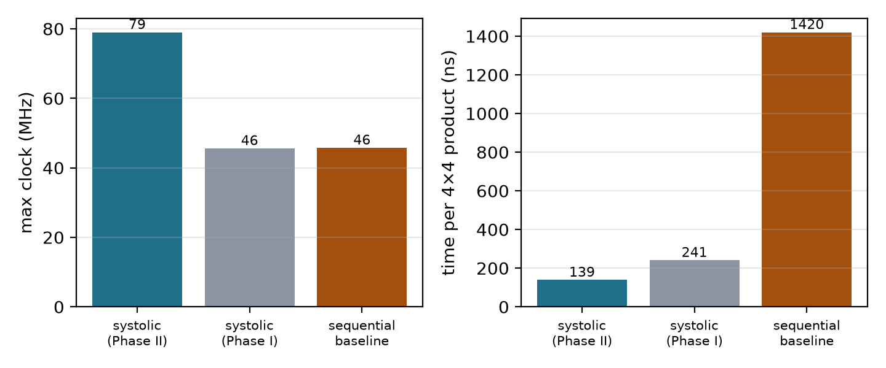
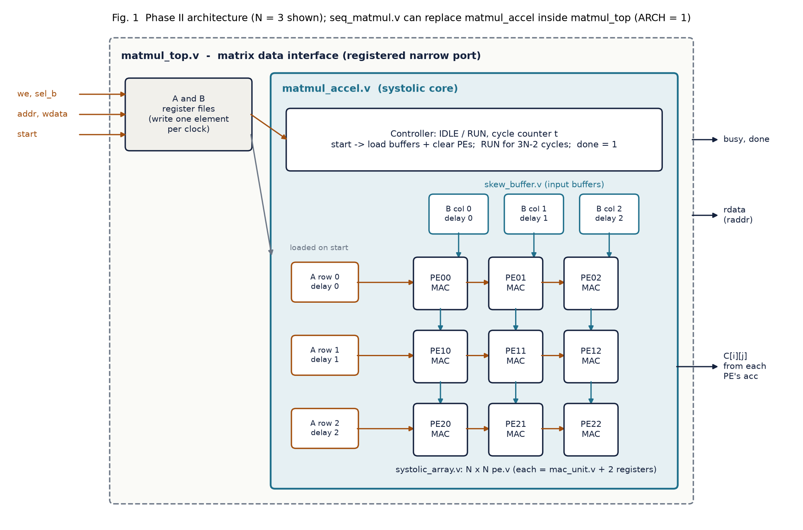
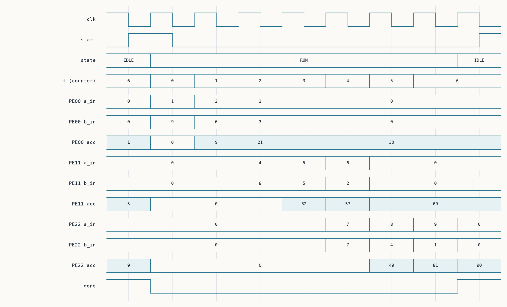

# Systolic Array Matrix Multiplication Accelerator

A parameterised N × N systolic array that computes `C = A × B` for signed 8-bit
(integer or Q4.4 fixed-point) matrices, written in synthesisable Verilog-2005,
verified against a reference model, synthesised for FPGA and compared with a
sequential single-MAC baseline.

**Course:** Modern Computer Architecture · **Team:** `MCA_Project_2024_C_Team1` (Section C) · **Project 12** · **Phase II (final)**

| Deliverable | Where |
| --- | --- |
| Final report (IEEE format) | [`report/report.pdf`](report/report.pdf) · source: [`report/report.tex`](report/report.tex) |
| Phase I report | [`report/phase1/report_phase1.pdf`](report/phase1/report_phase1.pdf) |
| Prototype / demo video | [Google Drive folder](https://drive.google.com/drive/folders/1Z8AsM1CW7a-qBB9LZiPCugjUo8qW30LH?usp=sharing) |
| RTL implementation | [`rtl/`](rtl) |
| Testbenches | [`tb/`](tb) |
| Synthesis scripts and results | [`synth/`](synth) · [`synth/results.csv`](synth/results.csv) |
| Figures (block diagram, FSM, waveform, charts) | [`docs/figures/`](docs/figures) |
| Simulation logs | [`docs/logs/`](docs/logs) |

## Team

| Name | Enrolment No. | Email |
| --- | --- | --- |
| Anurag Kumar (Team Lead) | 2401010088 | anurag.kumar2024@nst.rishihood.edu.in |
| Augustya Purohit | 2401010114 | augustya.purohit2024@nst.rishihood.edu.in |
| Harsh Raj | 2401010180 | harsh.raj2024@nst.rishihood.edu.in |
| Sumit Yadav | 2401010464 | sumit.yadav2024@nst.rishihood.edu.in |
| Adil Mirza | 2401020005 | adil.mirza2024@nst.rishihood.edu.in |

## Results at a glance (4 × 4, 8-bit)

| | Systolic array (Phase II) | Systolic array (Phase I) | Sequential baseline |
| --- | --- | --- | --- |
| Latency (cycles, start → done) | **11** (3N − 1) | 11 | 65 (N³ + 1) |
| Max clock, iCE40 HX8K after place & route | **79.0 MHz** | 45.6 MHz | 45.8 MHz |
| Time per matrix product | **139 ns** | 241 ns | 1420 ns |
| Wall-clock speed-up vs baseline | **10.2×** | 5.9× | 1× |
| Xilinx 7-series (LUT / FF / DSP48E1) | 707 / 735 / 16 | 600 / 639 / 16 | 1141 / 973 / 3 |

All testbenches pass: 511/511 PE checks, 222/222 input-buffer checks, 104/104 array tests at N = 2, 3, 4, 5, 8, 16
(both feeder versions, and 16-bit operands), 205/205 comparison tests × 3 designs
at N = 3 and 4, and 320/320 elements through the data interface.



## Idea

Multiplying two N × N matrices takes N³ multiply-accumulate (MAC) operations. A
processor pushes them through one arithmetic unit, one after another. A systolic
array instead lays out N² MAC cells in a grid: operands of `A` flow left to
right, operands of `B` flow top to bottom, and every cell multiplies whatever
meets inside it and adds it to a running sum. All cells work on every clock
cycle, and every wire only reaches the next cell.



Row `i` of `A` is delayed by `i` cycles and column `j` of `B` by `j` cycles, so
`A[i][k]` and `B[k][j]` meet in `PE(i,j)` at cycle `t = i + j + k`. The whole
product is ready after **3N − 1 clock cycles** instead of N³.

## What Phase II added

| Change | Why |
| --- | --- |
| `mac_unit.v` split out of `pe.v` | The brief lists the MAC unit as its own module |
| `skew_buffer.v` input buffers replace the Phase I multiplexer feeders | Removes the counter + multiplexer from the critical path: 45.6 → 79.0 MHz, same latency. `BUFFERED=0` keeps the Phase I version for comparison |
| `seq_matmul.v` sequential baseline | A real design to compare against, not just the N³ formula |
| `matmul_top.v` matrix data interface | 640 parallel pins → a narrow register-mapped port that fits an FPGA |
| `tb_compare.v`, `tb_matmul_top.v` | Same inputs to all three designs, Q4.4 fixed-point test, cycle measurements, interface test |
| `tb_skew_buffer.v` | Unit test of the input buffer on its own: delays 0, 1 and 3, hold, reload while shifting, random cycles against a model |
| `synth/` | Yosys + nextpnr resource and Fmax results; Vivado script for Artix-7 |
| `tools/`, `docs/figures/` | Block diagram, PE and FSM diagrams, waveform, performance charts |
| `report/report.pdf` | Final IEEE report with Results and Discussion and Conclusion |

## Repository layout

```
rtl/mac_unit.v         multiply-accumulate unit
rtl/pe.v               processing element: mac_unit + 2 forwarding registers
rtl/systolic_array.v   N x N mesh of processing elements (generate loops)
rtl/skew_buffer.v      input buffer: shift register that adds the row/column delay
rtl/matmul_accel.v     systolic core: controller + input buffers + mesh
rtl/seq_matmul.v       sequential baseline: one MAC, i-j-k loop
rtl/matmul_top.v       matrix data interface (narrow FPGA port), selects the core
tb/tb_pe.v             unit test of one processing element
tb/tb_skew_buffer.v    unit test of the input buffer (delays 0, 1, 3)
tb/tb_matmul_accel.v   array test: directed + random, reference model
tb/tb_compare.v        systolic (Phase II and I) vs sequential, same inputs
tb/tb_matmul_top.v     data interface test
synth/                 run_synth.sh, vivado_synth.tcl, reports/, results.csv
tools/                 Python cycle model, waveform renderer, diagram generator
docs/figures/          figures used in the report
docs/logs/             captured simulation output
report/                final IEEE report (LaTeX + PDF); phase1/ holds the Phase I report
```

## Top-level interface (`matmul_accel`)

| Port | Dir | Width | Description |
| --- | --- | --- | --- |
| `clk`, `rst` | in | 1 | clock, synchronous active-high reset |
| `start` | in | 1 | pulse to load `a_flat`/`b_flat` and begin |
| `a_flat`, `b_flat` | in | `N*N*DATA_W` | input matrices, element `[r][c]` at index `r*N + c` |
| `c_flat` | out | `N*N*ACC_W` | result matrix, same indexing |
| `busy` | out | 1 | high while the array is computing |
| `done` | out | 1 | high when `c_flat` is valid; stays high until the next `start` |

Parameters: `N` (default 4), `DATA_W` (default 8, signed), `ACC_W` (default 24),
`BUFFERED` (1 = input buffers, 0 = Phase I multiplexers).
Overflow cannot occur when `ACC_W >= 2*DATA_W + ceil(log2(N))`.

`matmul_top` wraps the core (`ARCH = 0` systolic, `1` sequential) behind a narrow
port: write an element with `we`, `sel_b`, `addr`, `wdata`; pulse `start`; read
`C[i][j]` with `raddr` → `rdata`.

## Running it

Requires [Icarus Verilog](https://steveicarus.github.io/iverilog/)
(`brew install icarus-verilog` or `apt install iverilog`). Synthesis also needs
Yosys and nextpnr-ice40 (`brew install yosys nextpnr-ice40`); figures need
Python with matplotlib.

```bash
make sim-pe           # one processing element (511 checks)
make sim-skew         # input buffer (222 checks)
make sim              # 4 x 4 array (104 tests); make sim N=3, N=8, ...
make compare          # systolic vs sequential baseline, cycles and speed-up
make sim-top          # matrix data interface, both cores
make all-tests        # all of the above
make synth            # resources + Fmax -> synth/results.csv (about 1.5 minutes)
make figures          # regenerate docs/figures
make waves            # open build/waves.vcd in GTKWave
make report           # build report/report.pdf (needs tectonic)
```

Expected endings:

```
 ALL 511 PE CHECKS PASSED
 ALL 222 SKEW BUFFER CHECKS PASSED
 ALL 104 TESTS PASSED
 ALL 205 COMPARISON TESTS PASSED (3 designs each)
 MATRIX DATA INTERFACE: ALL 320 ELEMENTS CORRECT (20 matrices, both cores)
```

## Simulation waveform

The 3 × 3 "counting" test (`A = 1..9`, `B = 9..1`). PE11 starts 2 cycles after
PE00 and PE22 4 cycles after (the skew); the diagonal finishes at 30, 69, 90 and
`done` rises after 3N − 1 = 8 cycles.


